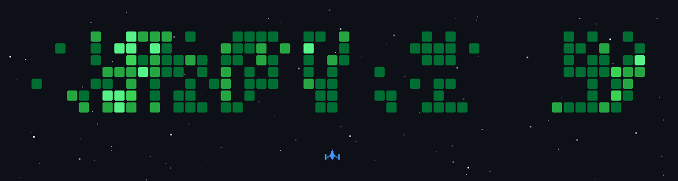
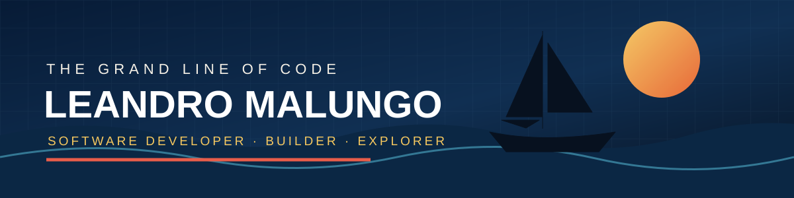

<!-- GitHub Profile README — Leandro Malungo -->

  

---

## Profile

I'm **Leandro Malungo**, a software developer based in Angola, Luanda. My work centres on building web and mobile applications, backend services and automation, with a growing interest in applied AI and data-driven products. I enjoy taking an idea from its first requirements through implementation, iteration and delivery. I am particularly interested in technology that solves concrete problems and creates opportunities.

## What I build

<table>
  <tr>
    <td width="33%" valign="top">
      

        
      

      <h3 align="center">Digital products</h3>
      
I turn ideas and real-world needs into useful web and mobile experiences — from interface design and frontend architecture to complete product delivery.

    </td>
    <td width="33%" valign="top">
      

        
      

      <h3 align="center">Backend &amp; infrastructure</h3>
      
I build APIs, data-driven services and integrations, connecting databases, automation and application logic into maintainable systems.

    </td>
    <td width="33%" valign="top">
      

        
      

      <h3 align="center">AI &amp; emerging technology</h3>
      
I explore applied AI, data and emerging technologies to develop practical solutions, test new approaches and turn complex challenges into opportunities.

    </td>
  </tr>
</table>

  

## Mission Log

THE JOURNEY IS IN PROGRESS — these are the areas I'm actively building towards.

<table>
  <tr>
    <td width="33%" valign="top">
      

      <h3 align="center">Useful products</h3>
      
Turn real needs and promising ideas into reliable digital products that people can use.

      
STATUS: ONGOING

    </td>
    <td width="33%" valign="top">
      

      <h3 align="center">Emerging technology</h3>
      
Explore applied AI, data and new technologies, focusing on practical use rather than hype.

      
STATUS: ONGOING

    </td>
    <td width="33%" valign="top">
      

      <h3 align="center">Learn &amp; contribute</h3>
      
Keep learning, collaborate with others and contribute to projects and the developer community.

      
STATUS: ONGOING

    </td>
  </tr>
</table>

## Technologies and tools I've worked with

A broad toolkit across modern software development, from interfaces and APIs to data, cloud and delivery.

**Frontend &amp; Mobile**

  

**Backend &amp; APIs**

  

**Databases, Cloud &amp; DevOps**

  
  

**Tools &amp; Workflow**

  

## A little more

  

## Connect

  
  
  
  
  

